<div align="center">

# NEXORA

**Intelligent workflow & collaboration ecosystem**

Kanban boards, a visual automation studio and explainable project intelligence, built as a microservice monorepo:
Spring Boot · React · Angular · Node.js · MySQL · Redis · Docker · Nginx.

[](https://github.com/sureshnarayananankumar/nexora/actions/workflows/ci.yml)


### [▶ Live demo](https://sureshnarayananankumar.github.io/nexora/) · [Admin console demo](https://sureshnarayananankumar.github.io/nexora/admin/)

<sub>The demo runs the real React and Angular builds in your browser with sample data. Sign in with the prefilled account; changes stay in your tab.</sub>

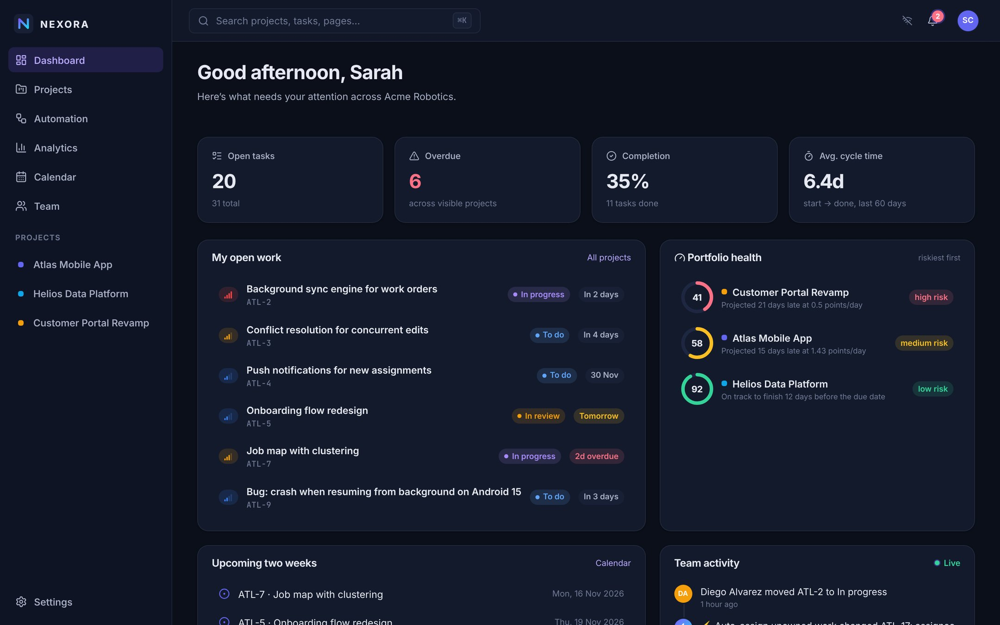

</div>

> Screenshots were captured from the built React and Angular apps running against a local mock API with **sample data**. They show the real UI, not live production data.

---

## Contents

- [What it does](#what-it-does)
- [Features that make it different](#features-that-make-it-different)
- [Architecture](#architecture)
- [Tech stack](#tech-stack)
- [Screenshots](#screenshots)
- [Getting started](#getting-started)
- [Testing](#testing)
- [Project structure](#project-structure)
- [Security](#security)
- [Verification status](#verification-status)
- [Roadmap](#roadmap)

## What it does

NEXORA is a multi-tenant work management platform for teams running several projects at once.

- **Users** (React app) plan work on Kanban boards, comment, follow milestones on a calendar, and automate routine steps.
- **Managers** see which projects are at risk and why, which tasks to do next, and who is overloaded.
- **Platform admins** (Angular console) manage organisations, users, roles, subscription plans, settings and audit logs, and watch API and realtime health.

## Features that make it different

Every "smart" feature is a documented algorithm whose output includes its reasons. There is no black-box AI.

| Feature | How it works |
|---|---|
| **Visual workflow builder** | Drag triggers, conditions and actions onto a React Flow canvas. The API validates the graph (Kahn's algorithm for cycles, reachability, per-node config) and runs it on real task events. Each run executes in its own transaction and rolls back on failure. A **dry run** traces any workflow against a real task without writing anything. |
| **Execution history** | Every run stores per-step status, timing and output, and both apps show it as a timeline. |
| **Project health score** | 0–100, starting at 100 minus capped penalties: overdue work (30), schedule slip (25), blocked tasks (15), stale work (10), unowned urgent work (10), overload (10). Each factor shows the penalty and the tasks behind it. |
| **Risk detection & forecast** | Projected finish date from 14-day throughput, compared with the due date: "Projected 15 days late at 1.43 points/day". |
| **Priority recommendations** | A score from urgency (due date), how many tasks this one blocks, current priority, milestone pressure and age. Each suggestion lists its reasons and can be applied in one click. |
| **Workload balancing** | Load = open points ÷ weekly capacity. A greedy planner suggests moves from overloaded members to the member with the most spare capacity. |
| **Realtime collaboration** | Live boards, comments, notifications, presence and typing indicators. The API writes events to a Redis Stream; a Node Socket.IO gateway fans them out to project, user and organisation rooms. |
| **Customisable analytics** | Drag-to-arrange widgets (throughput, status mix, utilisation, cycle time, automation volume). The layout is saved per user. |
| **Activity timeline & notifications** | Every change is recorded, and assignments, comments, due dates and automations notify the right people. |
| **Enterprise controls** | RBAC with data-driven permissions, plan limits enforced by the API (`402 PLAN_LIMIT_REACHED`), an append-only audit log, runtime settings and API metrics. |

## Architecture

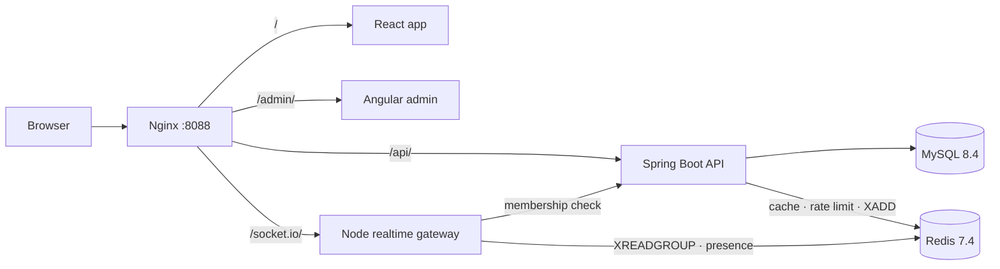

- **Spring Boot API**: REST API, auth, RBAC, workflow engine, insights, analytics, audit and Flyway migrations.
- **Node realtime gateway**: Socket.IO with JWT auth, rooms, presence and typing. It reads the `nexora:events` stream through the `realtime` consumer group and acknowledges each event.
- **React app**: the user product. **Angular app**: the platform admin console.
- **Nginx**: a single origin for everything, so the refresh cookie stays `SameSite=Strict`.

Diagrams, data flows, the ER model and the RBAC matrix are in **[docs/architecture.md](docs/architecture.md)**. Endpoints and socket events are in **[docs/api-documentation.md](docs/api-documentation.md)**.

## Tech stack

| Layer | Technology |
|---|---|
| API | Java 21, Spring Boot 3.5, Spring Security, JPA/Hibernate, Flyway, jjwt, springdoc-openapi, Testcontainers |
| User app | React 19, TypeScript, Vite 7, React Router 7, TanStack Query 5, Zustand, React Flow, dnd-kit, Recharts, React Hook Form + Zod |
| Admin app | Angular 20 (standalone components, signals, OnPush, lazy routes, functional guards and interceptors) |
| Realtime | Node 22, Express 5, Socket.IO 4, ioredis |
| Data | MySQL 8.4, Redis 7.4 (Streams, cache, rate limiting, presence) |
| Delivery | Docker multi-stage builds, Docker Compose, Nginx, GitHub Actions (CI + GHCR images) |

## Screenshots

*Sample data, captured from the real built apps.*

| | |
|---|---|
| 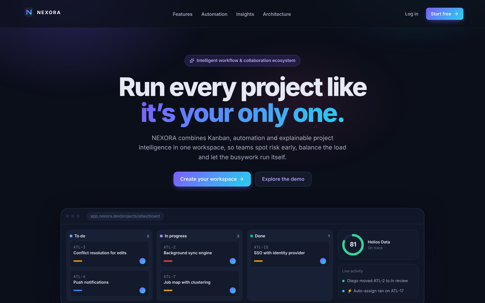 **Landing page** | 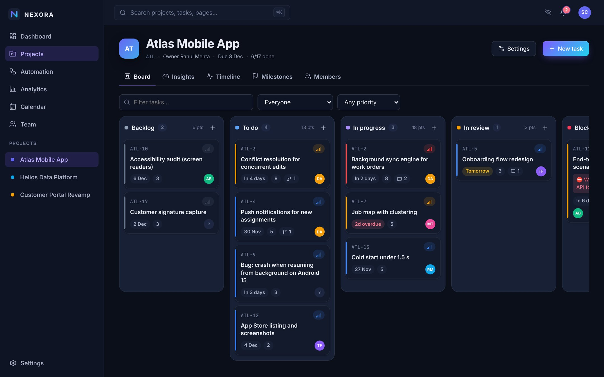 **Kanban board with live presence** |
| 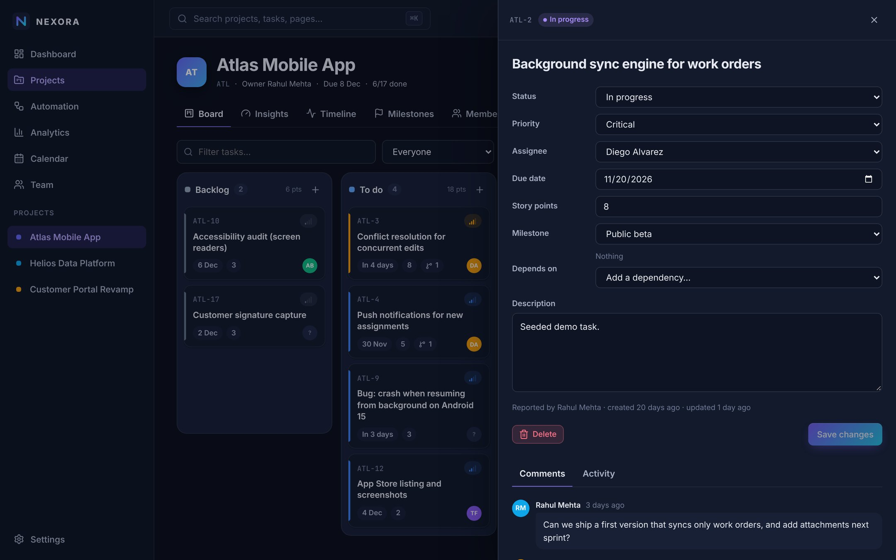 **Task drawer: comments, dependencies, activity** | 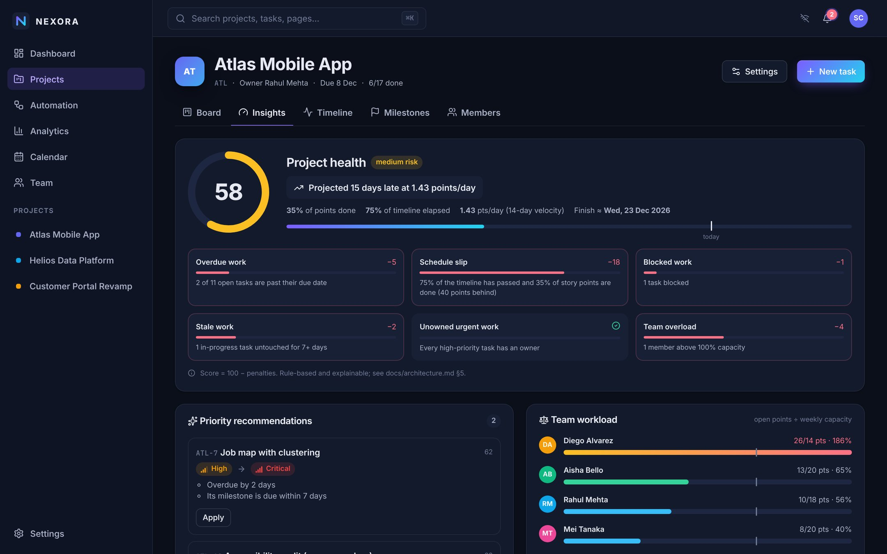 **Health score, forecast and recommendations** |
| 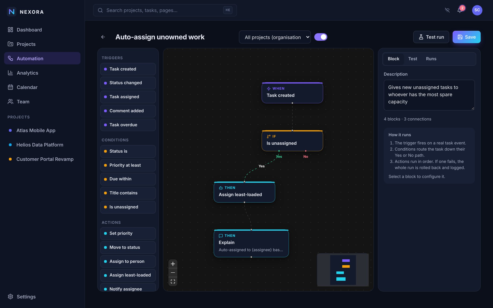 **Visual workflow builder** | 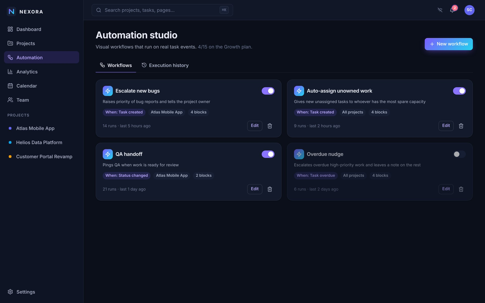 **Automation studio** |
| 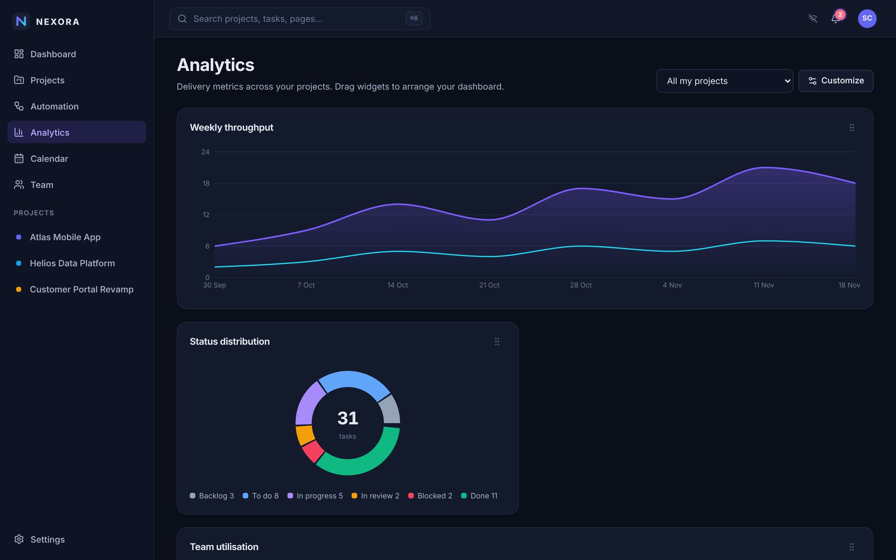 **Customisable analytics** | 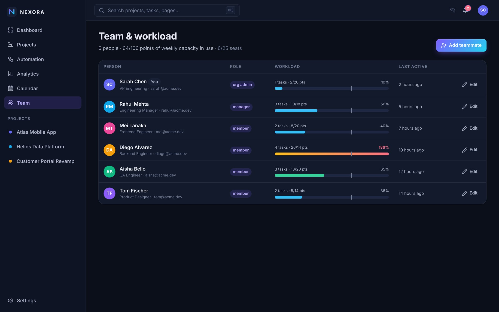 **Team workload** |
| 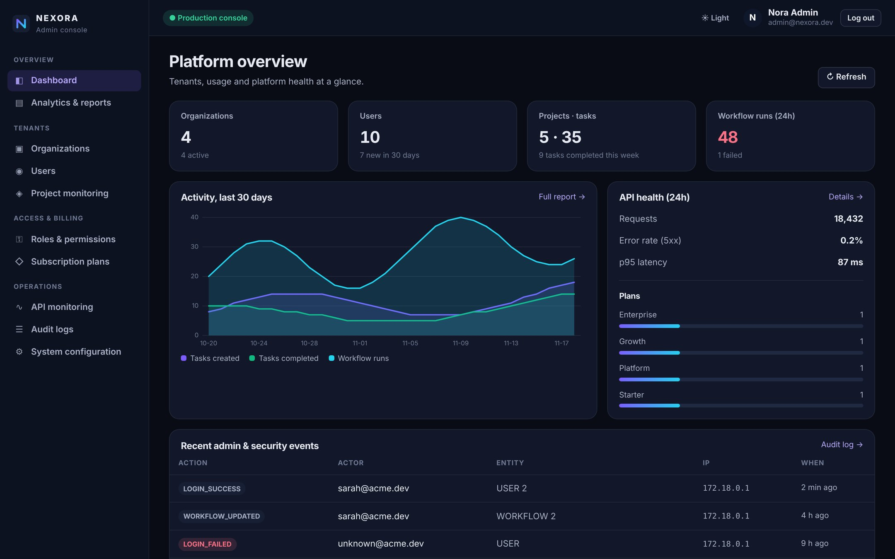 **Admin: platform overview** | 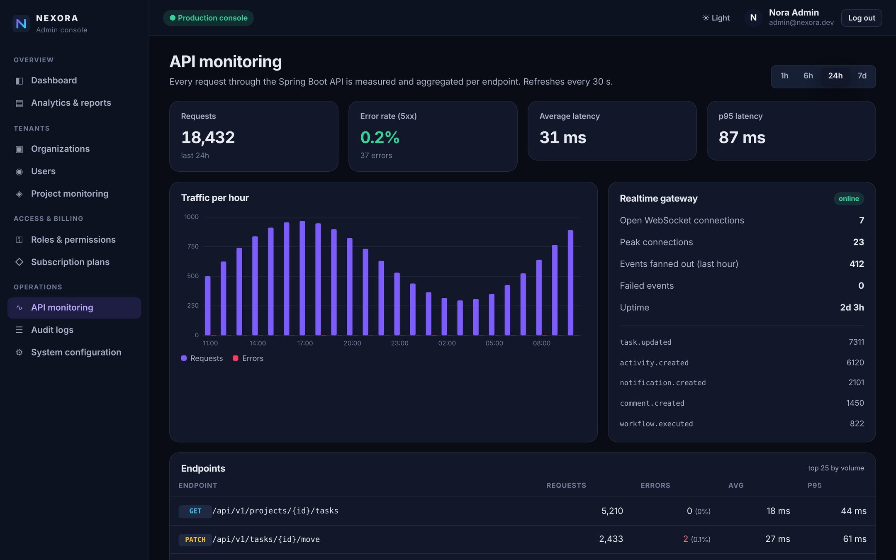 **Admin: API monitoring** |
| 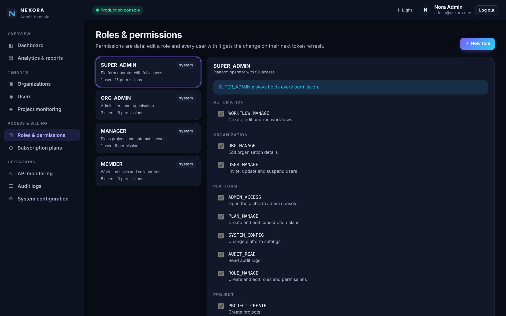 **Admin: roles & permissions** | 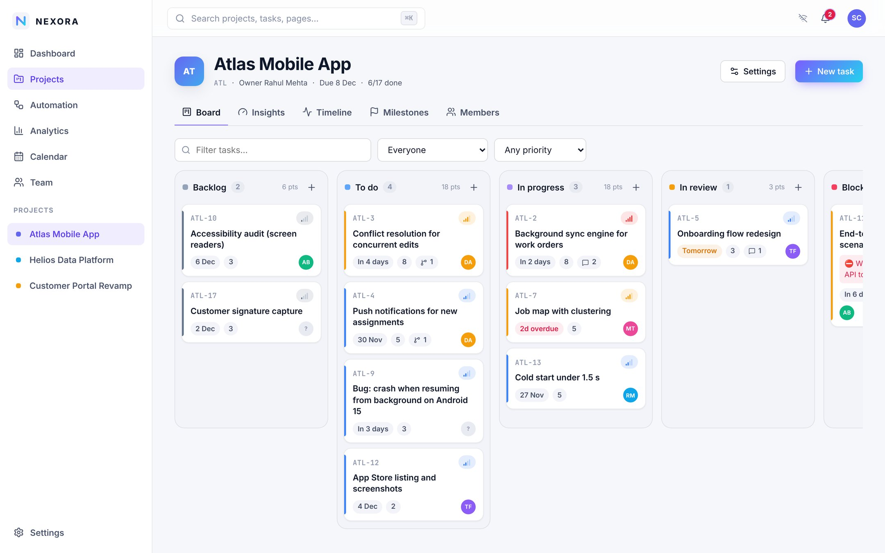 **Light theme** |

## Getting started

### Try it online

The **[live demo](https://sureshnarayananankumar.github.io/nexora/)** is the real React app, and the **[admin demo](https://sureshnarayananankumar.github.io/nexora/admin/)** is the real Angular console, both built in demo mode and hosted on GitHub Pages. Instead of the Spring Boot API, a small in-browser layer ([`frontend/demo-api`](frontend/demo-api/demo-api.js)) answers API calls with sample data, so boards, task edits, comments, insights and workflow test runs all work, but nothing is saved. Realtime presence needs the Node gateway, so it is off in the demo. Normal builds don't include the demo layer. The site is built by [`build-pages-demo.sh`](infrastructure/scripts/build-pages-demo.sh) and deployed by the `Demo site` workflow.

### Option A: the whole stack in Docker

Requires Docker with Compose v2.

```bash
git clone https://github.com/sureshnarayananankumar/nexora.git
cd nexora
cp .env.example .env          # then change every value, especially JWT_SECRET
docker compose up -d --build
bash infrastructure/scripts/smoke-test.sh http://localhost:8088
```

| URL | What |
|---|---|
| http://localhost:8088 | React app |
| http://localhost:8088/admin/ | Angular admin console |
| http://localhost:8088/api/swagger-ui.html | Swagger UI |

With `NEXORA_SEED_DEMO=true`, the first start creates demo data. Log in as `sarah@acme.dev` (org admin), `rahul@acme.dev` (manager) or `mei@acme.dev` (member) in the app, or as `admin@nexora.dev` in the admin console. The password is the `NEXORA_DEMO_PASSWORD` you set in `.env`. Demo seeding is for local use only; set `NEXORA_SEED_DEMO=false` anywhere else.

### Option B: run each service locally

```bash
docker compose -f docker-compose.dev.yml --env-file .env up -d   # MySQL :3306 + Redis :6379
set -a; . ./.env; set +a                                            # export the same values

cd backend/springboot-api && mvn spring-boot:run      # API on :8080 (Flyway migrates on start)
cd backend/node-realtime  && npm ci && npm run dev    # realtime on :4000
cd frontend/react-client  && npm ci && npm run dev    # http://localhost:5173
cd frontend/angular-admin && npm ci && npm start      # http://localhost:4200
```

The Vite and Angular dev servers proxy `/api` and the socket to the local services.

## Testing

| Project | Command | What it covers |
|---|---|---|
| Spring Boot | `mvn verify` | Unit tests: health calculator, priority recommender, workload balancer, graph validator, condition evaluator, JWT service, API metrics |
| Spring Boot | `mvn verify -Pintegration` | Full API flow against real MySQL and Redis (Testcontainers) |
| Node realtime | `npm test` | Unit tests; Socket.IO auth, rooms and presence; Redis Stream consumer against a real `redis-server` |
| React | `npm test` | API client (single-flight refresh, error mapping, sign-out), login form, board ordering, client-side workflow validation, formatting |
| Angular | `npm run test:ci` | Auth service, interceptor refresh, guards, login form validation, chart and pipes (Karma, headless Chrome) |
| Whole stack | `infrastructure/scripts/smoke-test.sh` | Through Nginx: both SPAs, auth and cookie rotation, seeded data, task creation, insights, Socket.IO, admin RBAC |

GitHub Actions runs all of these on every push, and the `e2e` job runs `docker compose up` and the smoke test.

## Project structure

```
nexora/
├── backend/
│   ├── springboot-api/      # Spring Boot REST API (com.nexora.*)
│   └── node-realtime/       # Socket.IO gateway
├── frontend/
│   ├── react-client/        # user app
│   └── angular-admin/       # admin console
├── database/migrations/     # Flyway SQL (V1 schema, V2 reference data)
├── infrastructure/
│   ├── docker/              # Dockerfiles (build context = repo root)
│   ├── nginx/               # gateway config
│   └── scripts/             # smoke test
├── docs/                    # architecture, API reference, screenshots
├── docker-compose.yml       # full stack
├── docker-compose.dev.yml   # MySQL + Redis for local dev
└── .github/workflows/       # CI and image publishing
```

## Security

- Access tokens (HS256, 15 min) are held only in memory in the browser. Refresh tokens are HttpOnly, `SameSite=Strict` cookies scoped to `/api/v1/auth`, stored hashed, and rotated on every use. Reusing a refresh token revokes all of that user's sessions.
- Passwords are hashed with BCrypt. Failed logins are rate-limited per email and IP in Redis.
- Every query is scoped to the caller's organisation, and project routes check READ / WRITE / MANAGE membership.
- The realtime gateway verifies the same JWT and asks the API before joining a socket to a project room.
- Security-relevant actions are written to an append-only audit log.
- No secrets live in the repo. `.env` is git-ignored, `.env.example` holds placeholders only, and the API refuses to start without a `JWT_SECRET` of at least 32 bytes.

## Verification status

Every check below has been run. GitHub Actions repeats them all on each push.

| Check | Status |
|---|---|
| Spring Boot: compile, 20 unit tests, and the `ApiFlowIT` integration test against real MySQL 8.4 + Redis 7.4 (Testcontainers) | ✅ GitHub Actions |
| Full stack: `docker compose up --build --wait` (all services healthy), then 11 smoke checks through Nginx | ✅ GitHub Actions |
| Docker images for api, realtime, web, admin and nginx built and pushed to GHCR | ✅ GitHub Actions |
| React: type-check, 11 unit tests, production build | ✅ locally and on GitHub Actions |
| Angular: production build, 7 unit tests (headless Chrome) | ✅ locally and on GitHub Actions |
| Node realtime: type-check, 15 tests (including a real Redis), build | ✅ locally and on GitHub Actions |
| Both UIs rendered and screenshotted against a mock API with sample data | ✅ locally |
| Pages demo: both demo builds walked through in a browser (sign-in, board, create task, comment, insights, workflow builder, deep links, admin console) | ✅ locally |

## Roadmap

- Email and Slack delivery for notifications
- Recurring tasks and SLA timers as workflow triggers
- OpenTelemetry tracing across API and gateway
- Kubernetes manifests / Helm chart

## License

[MIT](LICENSE) © Suresh Kumar N
