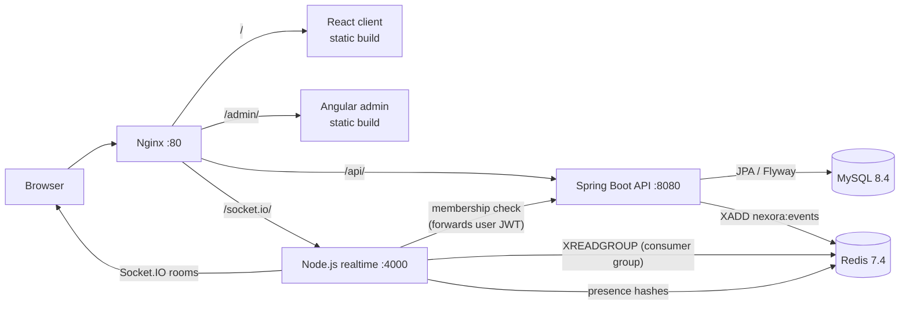
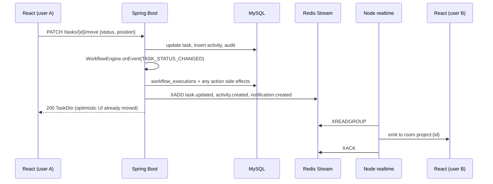
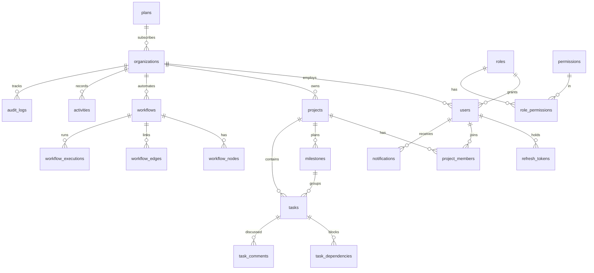

# NEXORA architecture

NEXORA is a workflow and collaboration platform for teams that run many projects at once. This document is the Phase 1 design: what the product does, how the services split the work, how data flows, and how the "intelligent" features are calculated.

## 1. Product requirements

### Personas

| Persona | App | Needs |
|---|---|---|
| **Member** | React client | See my tasks, move work across the board, comment, get notified |
| **Manager** | React client | Plan projects, balance workload, spot risk early, automate busywork |
| **Org admin** | React client | Invite people, set roles, own the organisation's workflows |
| **Platform admin** | Angular admin | Run the whole SaaS: tenants, plans, roles, audit, config, API health |

### Functional scope

1. **Accounts and security**: registration (creates an organisation), login, JWT access tokens, rotating refresh tokens, role-based access control with fine-grained permissions.
2. **Projects**: create, edit, archive; members with project roles; milestones; calendar.
3. **Tasks**: Kanban board with drag-and-drop between and within columns, story points, due dates, dependencies, assignee, comments, activity.
4. **Workflow automation studio**: a visual graph editor (trigger → conditions → actions) that is saved, validated and **executed by the backend** when matching events happen, with a full execution history and a dry-run tester.
5. **Insights** (rule-based, explainable, no ML claims): project health score, delay and risk detection, task priority recommendations, team workload balancing with reassignment suggestions.
6. **Collaboration**: real-time board updates, presence ("who is online in this project"), typing indicators on comments, live notifications.
7. **Analytics**: throughput, status distribution, workload, health trend; a dashboard whose widgets each user can show, hide and reorder (saved server-side).
8. **Administration**: users, roles and permissions, organisations, plans with enforced limits, audit logs, system settings that change behaviour, API monitoring.

### Non-functional requirements

- Every write is authorised server-side; the UI hides actions the user can't perform, but the API is the source of truth.
- Multi-tenant isolation: every query for tenant data is scoped by `organization_id` taken from the token, never from the request body.
- Secrets only come from environment variables; `.env.example` holds placeholders.
- `docker compose up --build` starts the full stack behind one origin.

## 2. Service responsibilities



| Service | Owns | Does not do |
|---|---|---|
| **Spring Boot API** | All business rules, persistence, auth, RBAC, workflow engine, insights, notifications (stored), audit, API metrics | Hold WebSocket connections |
| **Node.js realtime** | Socket.IO connections, JWT socket auth, rooms per org/project/user, presence, typing, consuming the event stream and fanning it out, live event counters | Write business data |
| **React client** | Product UI for members, managers, org admins | Admin of the platform |
| **Angular admin** | Platform administration UI | Day-to-day project work |
| **MySQL** | System of record | |
| **Redis** | Event stream (`nexora:events`), presence, short-lived caches (project insights, 60 s) | |
| **Nginx** | Single origin, TLS-ready reverse proxy, WebSocket upgrade, SPA fallbacks, gzip, security headers | |

### Why a stream instead of pub/sub

Spring writes domain events with `XADD` to a Redis Stream. The Node service reads them through a **consumer group** and acknowledges each one after fan-out. If the realtime service restarts, unacknowledged events are re-delivered, so notifications aren't silently lost. Pub/sub would drop them.

## 3. Key flows

### Login and token refresh

1. `POST /api/v1/auth/login` returns a 15-minute **access token** (HS256 JWT with `sub`, `org`, `role`, `perms`) in the body, and sets a 7-day **refresh token** in an `HttpOnly; SameSite=Strict; Path=/api/v1/auth` cookie. The admin app uses a separate cookie name so both apps can be open in the same browser.
2. Only a SHA-256 hash of the refresh token is stored.
3. `POST /api/v1/auth/refresh` **rotates** the token. If a revoked token is presented again (a sign of theft), every refresh token for that user is revoked.
4. Both front ends retry a request once after a `401` by refreshing; concurrent requests share one refresh.

### Moving a task (end to end)



## 4. Workflow automation engine

A workflow is a directed acyclic graph stored as `workflow_nodes` plus `workflow_edges`.

| Node type | Kinds |
|---|---|
| **Trigger** (exactly one) | `TASK_CREATED`, `TASK_STATUS_CHANGED`, `TASK_ASSIGNED`, `COMMENT_ADDED`, `TASK_OVERDUE` (checked by a scheduler every 15 min) |
| **Condition** (true/false branches) | `STATUS_IS`, `PRIORITY_AT_LEAST`, `DUE_WITHIN_DAYS`, `TITLE_CONTAINS`, `IS_UNASSIGNED` |
| **Action** | `SET_PRIORITY`, `SET_STATUS`, `ASSIGN_USER`, `ASSIGN_LEAST_LOADED`, `NOTIFY_ASSIGNEE`, `NOTIFY_USER`, `NOTIFY_PROJECT_OWNER`, `ADD_COMMENT` |

Execution:

1. On a domain event, load enabled workflows for the project (and organisation-wide ones) whose trigger matches.
2. Walk the graph breadth-first from the trigger. A condition node follows its `TRUE` or `FALSE` edge; an action node runs, then follows its outgoing edges.
3. Every step is recorded (`node`, `result`, `message`, `ms`) in `workflow_executions.steps` with an overall status `SUCCESS`, `FAILED` or `SKIPPED`.
4. Loop protection: changes made by a workflow action carry an "automation" flag and do not trigger workflows again; a hard cap of 50 steps per run.
5. Saving validates the graph: one trigger, no cycles (Kahn's algorithm), every node reachable from the trigger, every condition has both branches at most once, config fields are present.
6. **Dry run**: `POST /workflows/{id}/test {taskId}` evaluates the graph against a real task without applying side effects and returns the step trace.

## 5. Intelligent features (explainable rules)

None of these use machine learning. Each one returns its reasons so the UI can show *why*.

### Project health score (0–100) and risk level

`health = 100 − Σ penalties`, each penalty capped:

| Factor | Signal | Max penalty |
|---|---|---|
| Overdue work | open tasks past due ÷ open tasks × 30 | 30 |
| Schedule slip | `elapsed% − completed-points%`, if over 10 pts → scaled to 25 | 25 |
| Blocked work | blocked ÷ open × 15 | 15 |
| Stale work | in-progress tasks not updated for N days (setting `insights.stale_days`, default 7) × 2 | 10 |
| Unowned urgency | HIGH/CRITICAL tasks with no assignee × 3 | 10 |
| Overload | members above 100 % capacity × 4 | 10 |

Risk: `LOW` ≥ 75, `MEDIUM` 50–74, `HIGH` < 50.

**Delay forecast**: velocity = story points completed in the last 14 days ÷ 14. Remaining points ÷ velocity gives a projected finish date; if it lands after the project due date the API reports "projected N days late". With zero velocity it reports "no recent throughput" instead of inventing a date.

### Smart priority recommendation

```
score = urgency + blocking + current + milestone + age
urgency   = overdue 40 | due ≤ 2 days 30 | ≤ 7 days 18 | ≤ 14 days 8 | else 0
blocking  = 8 × open tasks that depend on this one (max 24)
current   = CRITICAL 20 | HIGH 12 | MEDIUM 6 | LOW 0
milestone = 10 if its milestone is due within 7 days
age       = days since created ÷ 3 (max 10)
```

`≥ 60 → CRITICAL`, `≥ 40 → HIGH`, `≥ 20 → MEDIUM`, else `LOW`. Only tasks whose recommended level differs from the current one are returned, each with its reasons and a one-click "apply".

### Workload balancing

- Load = sum of story points of a member's open tasks (unestimated tasks count as 3).
- Utilisation = load ÷ weekly capacity (`users.capacity_points`, default 20).
- `OVERLOADED` > 100 %, `BALANCED` 60–100 %, `AVAILABLE` < 60 %.
- Suggestions (greedy): for each overloaded member, take their not-yet-started tasks from lowest to highest priority and propose moving each to the project member with the most spare capacity who would stay at or under 100 %, until the source member is back under 100 %.
- `ASSIGN_LEAST_LOADED` in workflows uses the same utilisation numbers.

## 6. Data model



Full DDL with keys and indexes: [`database/migrations`](../database/migrations).

## 7. RBAC

| Role | Scope | Notable permissions |
|---|---|---|
| `SUPER_ADMIN` | Platform | everything, including `ADMIN_ACCESS`, `PLAN_MANAGE`, `SYSTEM_CONFIG`, `AUDIT_READ` |
| `ORG_ADMIN` | Organisation | `ORG_MANAGE`, `USER_MANAGE`, `PROJECT_CREATE`, `PROJECT_MANAGE`, `WORKFLOW_MANAGE`, `TASK_WRITE` |
| `MANAGER` | Organisation | `PROJECT_CREATE`, `PROJECT_MANAGE`, `WORKFLOW_MANAGE`, `TASK_WRITE` |
| `MEMBER` | Organisation | `TASK_WRITE`, `COMMENT_WRITE` |

Permissions are data, so platform admins can edit custom roles in the admin app; system roles can't be deleted.

## 8. Selected versions

| Component | Version | Notes |
|---|---|---|
| Java | 21 (LTS) | |
| Spring Boot | 3.5.x | Security 6, Data JPA, Validation, Actuator, Data Redis |
| Flyway | managed by Boot (`flyway-mysql`) | |
| jjwt | 0.12.6 | HS256 |
| springdoc-openapi | 2.8.x | Swagger UI at `/api/swagger-ui.html` |
| Node.js | 22 LTS | |
| Express | 5.x | |
| Socket.IO | 4.8 | |
| ioredis | 5.x | |
| React | 19.x + TypeScript 5.9 + Vite 7 | React Router 7, TanStack Query 5, @xyflow/react 12, @dnd-kit, Recharts 2 |
| Angular | 20.3 | standalone components, signals, lazy routes, functional guards and interceptors |
| MySQL | 8.4 LTS | |
| Redis | 7.4 | |
| Nginx | 1.28 (stable) | |
